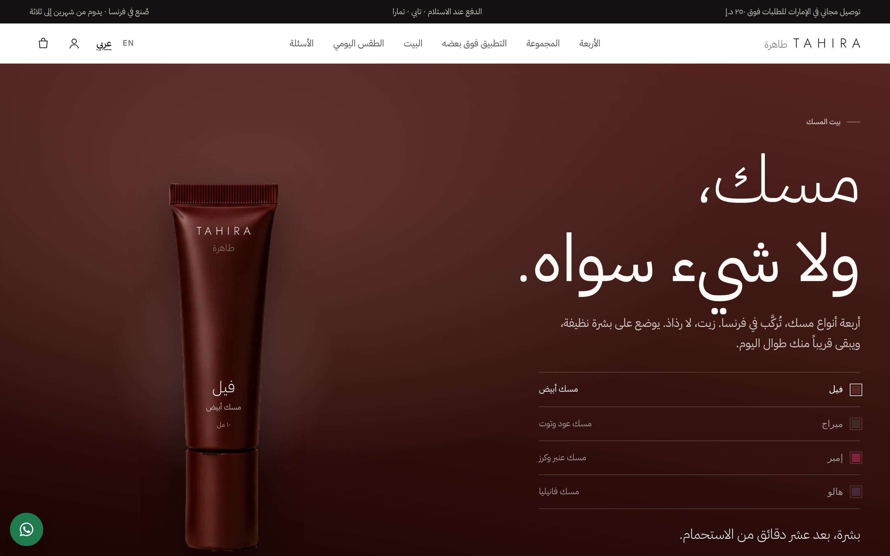

# TAHIRA : le thème Shopify

Le nouveau site de TAHIRA, la maison de musc, sous forme de thème Shopify complet.
Mêmes couleurs, même logo, mêmes photos que l'ancien site, mais une vraie boutique :
panier, paiement, Tabby, Tamara, paiement à la livraison, comptes clients, anglais et arabe.


| Mobile | Fiche produit | Arabe |
|---|---|---|
|  |  |  |

Autres aperçus : [les quatre musks](apercu/quatre-musks.jpg), [le constructeur de paires](apercu/paires-ordinateur.jpg),
[le panier](apercu/panier-ordinateur.jpg), [la fiche produit sur ordinateur](apercu/produit-ordinateur.jpg).

## Ce qui change par rapport à l'ancien site

| Avant | Maintenant |
|---|---|
| Une page HTML, le bouton « Checkout » ne menait nulle part | Un thème Shopify : vrai panier, vrai paiement, vraies commandes |
| Page d'accueil de 15 sections, les mêmes arguments répétés 5 ou 6 fois | 9 sections, chacune avec un rôle : choisir, rassurer, comparer, composer sa paire, offrir |
| Aucune preuve sociale | Une section avis et une section vidéos (UGC), prêtes à recevoir tes vrais avis et vidéos |
| Petits libellés gris de 10 px, durs à lire | 12 px minimum, contraste renforcé |
| Une seule adresse pour tout le site, invisible pour Google | Une vraie page par produit, données produit et FAQ lisibles par Google |
| Newsletter qui ne gardait les emails que dans le navigateur | Les inscrits arrivent dans Shopify > Clients, avec le tag « newsletter » |

Ce qui est gardé : le sélecteur des quatre musks en haut de page, le quiz « Which one is yours? »,
les paires avec le porte-tube offert, le coffret, le compte à rebours d'expédition (heure de Dubaï),
la ligne « 4 paiements avec Tabby ou Tamara », et tous les textes anglais et arabes de l'ancien site.

## Installer le thème

1. Télécharge `tahira-theme.zip` (dans ce dossier).
2. Dans Shopify : **Boutique en ligne > Thèmes > Ajouter un thème > Importer un fichier zip**.
3. Le thème arrive dans ta bibliothèque, non publié. Clique sur **Personnaliser** pour le voir avant de le publier.

## Le configurer (30 minutes)

### 1. Les produits

Crée six produits. Si tu reprends exactement ces identifiants (« handle », en bas de la fiche produit, partie SEO),
le thème les trouve tout seul :

| Produit | Handle | Prix |
|---|---|---|
| VEIL | `veil` | 169 AED |
| MIRAGE | `mirage` | 169 AED |
| EMBER | `ember` | 169 AED |
| HALO | `halo` | 169 AED |
| Le coffret | `coffret` | 549 AED, prix barré 676 AED |
| Le porte-tube | `bag-charm` | 45 AED |

Crée ensuite une collection avec le handle `musks` qui contient les quatre musks et le coffret.

Sinon, choisis-les à la main : **Personnaliser > Paramètres du thème > The four musks**.

Les notes olfactives, l'histoire, « comment le porter », la fiche technique et les barres Présence / Tenue
sont déjà écrites dans le thème, en anglais et en arabe, pour les quatre musks et le coffret.
La description que tu écris dans Shopify s'affiche en plus, dans un onglet « Read more ».

### 2. Le porte-tube offert avec chaque paire

Le constructeur de paires ajoute les deux musks et le porte-tube au panier. Pour qu'il soit gratuit :
**Remises > Créer une remise > Achetez X, obtenez Y** : la cliente achète 2 articles de la collection `musks`,
elle obtient « Le porte-tube » à 100 %. Coche « Automatique ». Le panier affiche alors « Offered ».

### 3. L'arabe

**Paramètres > Langues > Ajouter une langue > Arabe**, puis **Publier**.
Tous les textes du thème sont déjà traduits et la page passe en lecture de droite à gauche.
Pour traduire les titres et descriptions de tes produits, installe l'app gratuite **Translate & Adapt** de Shopify.

### 4. Les pages

Crée ces pages (**Boutique en ligne > Pages**), avec ce handle et ce modèle (« Modèle de thème », à droite) :

| Page | Handle | Modèle |
|---|---|---|
| The house | `the-house` | `page.house` |
| The ritual | `the-ritual` | `page.ritual` |
| Questions | `questions` | `page.faq` |
| The words | `the-words` | `page.words` |
| Contact | `contact` | `page.contact` |

Laisse le contenu vide : tout le texte est dans le modèle. Le menu et le pied de page affichent ces pages
automatiquement dès qu'elles existent.

### 5. Paiement et livraison

- **Paiement à la livraison** : Paramètres > Paiements > Méthodes de paiement manuelles > Paiement à la livraison.
- **Tabby et Tamara** : installe leurs apps officielles depuis l'App Store Shopify.
- **Livraison** : Paramètres > Expédition et livraison : 20 AED, gratuite à partir de 250 AED.
  Le seuil de la barre de progression du panier se règle dans Paramètres du thème > Orders.
- **Affichage des prix** : Paramètres > Général > Devise de la boutique > Modifier le format :
  mets `{{amount_no_decimals}} AED` pour afficher « 169 AED » comme sur l'ancien site.

### 6. Contact, réseaux, WhatsApp

**Paramètres du thème > Contact and social** : ton numéro WhatsApp (format 971501234567) fait apparaître un bouton
WhatsApp sur toutes les pages. Ajoute aussi Instagram, TikTok et Snapchat.

### 7. Les avis

La section « Reviews » reste invisible tant qu'elle est vide. Deux façons de la remplir :

- installe **Judge.me** (gratuit) puis ajoute son bloc d'app dans la section Reviews (accueil et fiche produit).
  Les étoiles apparaissent alors aussi sous le nom des musks ;
- ou ajoute des blocs « Review » à la main.

Mets uniquement de vrais avis clients.

### 8. Les vidéos

La section « Video reel » (accueil) affiche des vidéos verticales qui se lancent sans le son au défilement :
essais, déballages, vidéos de clientes. Elle reste invisible tant que tu n'en as pas ajouté.

## Modifier les textes

Dans l'éditeur Shopify, chaque section a des champs « Heading », « Text », etc. **Laisse-les vides** pour garder
le texte intégré, déjà traduit en arabe. Si tu écris ton propre texte, il remplace l'intégré ;
traduis-le alors avec Translate & Adapt.

Les sections de colonnes (« Columns ») proposent des contenus intégrés : la maison, Made in France,
la charte, le rituel, les six points de chaleur, huile contre spray, le glossaire, livraison et retours.

## Les fichiers

| Dossier | Contenu |
|---|---|
| `theme/` | le thème Shopify (c'est ce dossier qui est zippé) |
| `theme/locales/` | tous les textes : `en.default.json` (anglais), `ar.json` (arabe) |
| `theme/assets/` | le style, le JavaScript et les photos des tubes |
| `tahira-theme.zip` | le thème prêt à importer dans Shopify |
| `apercu/` | les captures ci-dessus |

Pour refaire le zip après une modification :

```bash
cd tahira/theme && zip -r -X ../tahira-theme.zip . -x '.*'
```

## Ce qui a été vérifié

- **Shopify Theme Check** (l'outil officiel) : aucune erreur. Il reste seulement les avertissements sur les polices
  Google Fonts, chargées depuis Google plutôt que depuis Shopify (sans conséquence).
- **Rendu** de 13 pages avec de faux produits, en anglais et en arabe, sur ordinateur et sur mobile :
  aucun texte manquant.
- **Parcours d'achat** simulé dans un navigateur (18 vérifications) : choix d'un musk dans le hero, ajout au panier,
  changement de quantité, constructeur de paires (deux musks et le porte-tube), quiz, compte à rebours,
  barre d'achat mobile, sens de lecture arabe, aucune erreur JavaScript.

Ce qui n'a pas pu être testé ici : le thème sur une vraie boutique Shopify (il faut tes accès).
Vérifie le parcours complet jusqu'au paiement dans l'aperçu du thème avant de le publier.

## À prévoir de ton côté

- **De vraies photos produit** : les photos actuelles sont des rendus de tubes vierges,
  le nom TAHIRA est dessiné par-dessus par le site. Quand tu auras les photos du vrai packaging, mets-les dans
  les fiches produit, et désactive « Print the name on the cut-out tubes » si le nom est déjà imprimé.
- **Les premiers avis et vidéos** de clientes : c'est le levier de conversion qui manque le plus.
- **Les mentions légales** : Paramètres > Politiques (remboursement, confidentialité, conditions, livraison).
  Elles s'affichent automatiquement dans le pied de page.
