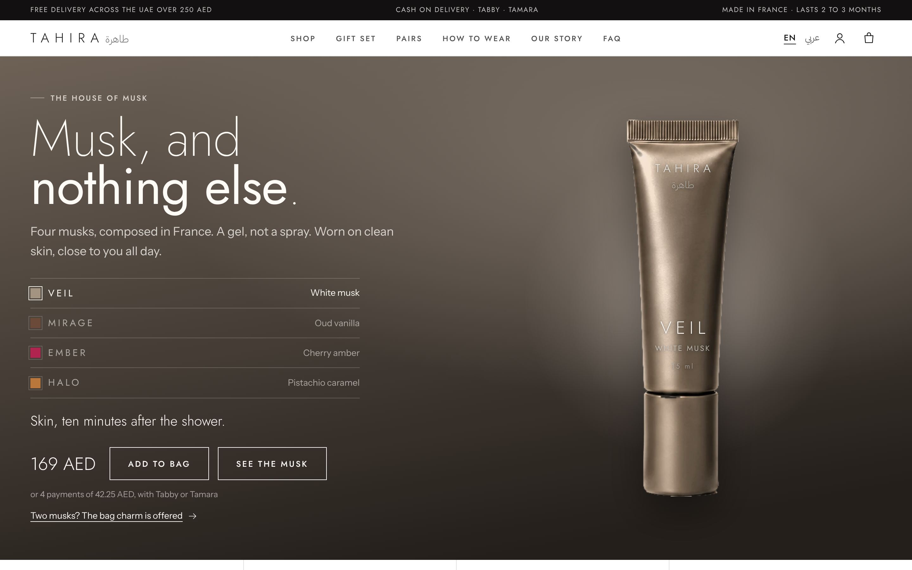
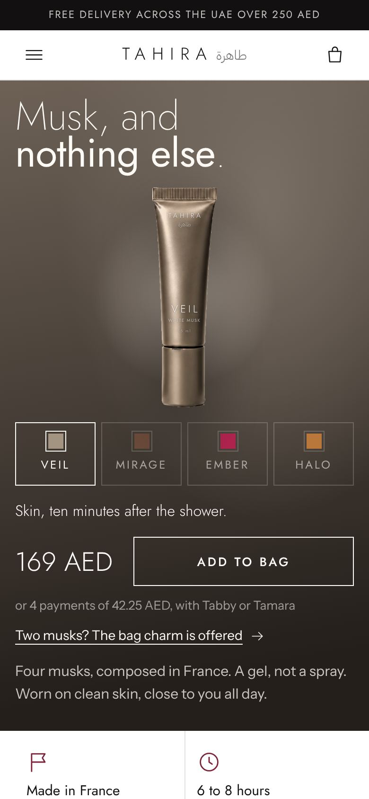
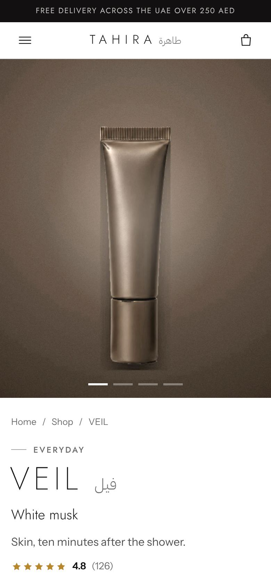

# TAHIRA : le thème Shopify

Le site de TAHIRA, la maison de musc, sous forme de thème Shopify complet.
Typographie fine et espacée, palette des quatre musks, motif arabe طاهرة en filigrane, et une vraie boutique :
panier, paiement, Tabby, Tamara, paiement à la livraison, comptes clients, anglais et arabe.
Pensé d'abord pour le téléphone (trafic Meta), sans aucune bibliothèque externe : même les polices sont servies par le thème.



| Mobile | Fiche produit | Arabe |
|---|---|---|
|  |  |  |

Autres aperçus : [les quatre musks](apercu/quatre-musks.jpg), [le constructeur de paires](apercu/paires-ordinateur.jpg),
[le panier](apercu/panier-ordinateur.jpg), [la fiche produit sur ordinateur](apercu/produit-ordinateur.jpg).

## La gamme

| Musk | Descripteur | Couleur du tube | Notes affichées (haut, cœur, fond) |
|---|---|---|---|
| VEIL | White musk | grège profond | coton propre, aldéhyde / musc blanc, iris poudré / bois doux, peau chaude |
| MIRAGE | Oud vanilla | brun chocolat | vanille / oud / musc blanc |
| EMBER | Cherry amber | rouge grenat | cerise noire / amande, musc blanc / ambre chaud |
| HALO | Pistachio caramel | brun caramel | pistache / caramel / musc blanc |

Le produit est un **gel parfumant** (« Alcohol-free oil-gel »), en tube souple de **15 ml** avec un bouchon.
Il n'y a ni applicateur ni mention de Grasse : seule l'allégation « composé et rempli dans un laboratoire français » est gardée.

Prix : tube 169 AED, paire 338 AED avec le porte-tube offert (valeur 45 AED), coffret 539 AED au lieu de 676 AED
(économie de 20 %). Livraison 29 AED, offerte dès 250 AED. Retours sous 14 jours, produit non ouvert.

## La page d'accueil, dans l'ordre

1. **Hero** : choix du musk, prix et bouton d'achat visibles dès le premier écran sur téléphone, lien vers les paires.
2. **Réassurance** : Made in France, 6 à 8 heures, sans alcool, paiement à la livraison.
3. **Les quatre musks**, en carrousel sur téléphone avec points de pagination.
4. **Le coffret**, juste après : c'est lui (avec la paire) qui porte la marge.
5. **Les paires** : on choisit deux musks, le texte de la paire s'affiche, les deux tubes et le porte-tube offert vont au panier.
6. Avis clients et vidéos (invisibles tant qu'ils sont vides), quiz, la maison, la citation en filigrane arabe, questions, newsletter.

## La navigation

Les intitulés du menu sont clairs ; la poésie reste dans les titres de sections.

| Avant | Maintenant (EN) | Maintenant (AR) |
|---|---|---|
| The chart | Shop | تسوّقي |
| The coffret | Gift set | طقم الهدية |
| Layering | Pairs | الثنائيات |
| The ritual | How to wear | طريقة الاستعمال |
| The house | Our story | قصتنا |
| The words | Glossary (menu mobile et pied de page) | المعجم |
| Questions | FAQ | الأسئلة الشائعة |

Sur téléphone, le menu sépare le groupe « The four musks » (avec la vraie teinte de chaque tube) des autres pages.
Pour changer un intitulé : `theme/locales/en.default.json` et `theme/locales/ar.json`, rubrique `nav`.

## Installer le thème

1. Télécharge `tahira-theme.zip` (dans ce dossier).
2. Dans Shopify : **Boutique en ligne > Thèmes > Ajouter un thème > Importer un fichier zip**.
3. Le thème arrive dans ta bibliothèque, non publié. Clique sur **Personnaliser** pour le voir avant de le publier.

## Le configurer (30 minutes)

### 1. La devise : AED, pas EUR

Le thème affiche les prix dans la devise de ta boutique. Si tu vois « EUR », c'est que la boutique est réglée en euros :
la cliente serait alors **débitée en euros** au paiement, quel que soit le texte affiché.
Il ne faut donc pas maquiller le symbole, il faut changer la devise elle-même :
**Paramètres > Général > Devise de la boutique > AED**. Shopify ne permet ce changement que tant qu'il n'y a pas
encore eu de vente ; sinon, passe par le support Shopify.

Ensuite, **Modifier le format** de la devise : mets `{{amount_no_decimals}} AED` pour afficher « 169 AED ».
Les échéances Tabby / Tamara gardent toujours leurs décimales (42.25 AED, 84.50 AED, 134.75 AED), le thème s'en charge.

### 2. Les produits

Crée six produits. Si tu reprends exactement ces identifiants (« handle », en bas de la fiche produit, partie SEO),
le thème les trouve tout seul :

| Produit | Handle | Prix |
|---|---|---|
| VEIL | `veil` | 169 AED |
| MIRAGE | `mirage` | 169 AED |
| EMBER | `ember` | 169 AED |
| HALO | `halo` | 169 AED |
| Le coffret | `coffret` | 539 AED, prix barré 676 AED |
| Le porte-tube | `bag-charm` | 45 AED |

Crée ensuite une collection avec le handle `musks` qui contient les quatre musks et le coffret.
Sinon, choisis-les à la main : **Personnaliser > Paramètres du thème > The four musks**.

Les notes, l'histoire, « comment le porter », la fiche technique, les jauges Presence / Hold, la pyramide olfactive
et la frise horaire (08:00 à 23:00) sont déjà écrites dans le thème, en anglais et en arabe.
La description que tu écris dans Shopify s'affiche en plus, dans un onglet « Read more ».

### 3. Le porte-tube offert avec chaque paire

Le constructeur de paires ajoute les deux musks et le porte-tube au panier. Pour qu'il soit gratuit :
**Remises > Créer une remise > Achetez X, obtenez Y** : la cliente achète 2 articles de la collection `musks`,
elle obtient « Le porte-tube » à 100 %. Coche « Automatique ». Le panier affiche alors « Offered ».

### 4. La livraison

**Paramètres > Expédition et livraison** : 29 AED, gratuite à partir de 250 AED. Tous les textes du site
(bandeau, fiche produit, questions) annoncent déjà ces montants.

### 5. Les informations réglementaires (dossier Montaji)

La fiche produit a un onglet « Regulatory information ». Pour le remplir, crée ces champs dans
**Paramètres > Données personnalisées > Produits > Ajouter une définition** :

| Nom | Espace de noms et clé | Type |
|---|---|---|
| INCI | `tahira.inci` | Texte multiligne |
| Numéro de lot | `tahira.batch` | Texte sur une ligne |
| Date de péremption | `tahira.expiry` | Texte sur une ligne |
| Pays d'origine | `tahira.origin` | Texte sur une ligne |
| Importateur aux Émirats | `tahira.importer` | Texte multiligne |

Remplis-les dans chaque fiche produit ; traduis-les en arabe avec l'app **Translate & Adapt**.
Le pays d'origine (« France ») et l'importateur peuvent aussi se régler une seule fois pour tous les produits :
**Paramètres du thème > Regulatory**. Tant qu'un champ est vide, il n'apparaît pas aux clientes ;
dans l'éditeur, tu vois sa place marquée « To be added with the regulatory file ».

### 6. L'arabe

**Paramètres > Langues > Ajouter une langue > Arabe**, puis **Publier**.
Tous les textes du thème sont déjà traduits et la page passe en lecture de droite à gauche.
Pour traduire les titres et descriptions de tes produits, installe l'app gratuite **Translate & Adapt**.

### 7. Les pages

Crée ces pages (**Boutique en ligne > Pages**), avec ce handle et ce modèle (« Modèle de thème », à droite) :

| Page | Handle | Modèle |
|---|---|---|
| Our story | `the-house` | `page.house` |
| How to wear | `the-ritual` | `page.ritual` |
| FAQ | `questions` | `page.faq` |
| Glossary | `the-words` | `page.words` |
| Contact | `contact` | `page.contact` |

Laisse le contenu vide : tout le texte est dans le modèle. Le menu et le pied de page les affichent
automatiquement dès qu'elles existent.

### 8. Paiement

- **Paiement à la livraison** : Paramètres > Paiements > Méthodes de paiement manuelles > Paiement à la livraison.
- **Tabby et Tamara** : installe leurs apps officielles depuis l'App Store Shopify.
- Le bouton de paiement express (Apple Pay, Shop Pay) est **désactivé** sur la fiche produit : il est noir plein et
  casse le style à filet fin. Pour le réactiver : section Product > « Show the express checkout button ».

### 9. WhatsApp, réseaux, widgets

**Paramètres du thème > Contact and social** : ton numéro WhatsApp ajoute un lien dans le menu, les questions et
la page contact. La bulle flottante est **désactivée par défaut** (case « Also show a floating WhatsApp button »).

Si une bulle verte reste en bas à droite, elle vient d'une app (Shopify Inbox, chat, avis...) :
**Personnaliser > icône Intégrations d'applications** (à gauche), désactive l'app concernée.

### 10. Avis et vidéos

La section « Reviews » reste invisible tant qu'elle est vide : installe **Judge.me** (gratuit) puis ajoute son bloc
d'app, ou ajoute des blocs « Review » à la main. Uniquement de vrais avis.
La section « Video reel » affiche des vidéos verticales (essais, déballages, clientes) qui se lancent sans le son.

## Modifier les textes et les couleurs

Dans l'éditeur Shopify, chaque section a des champs « Heading », « Text », etc. **Laisse-les vides** pour garder
le texte intégré, déjà traduit en arabe. Si tu écris ton propre texte, il remplace l'intégré ;
traduis-le alors avec Translate & Adapt.

Les couleurs sont dans **Paramètres du thème > Colours** : la couleur de fond de chaque musk (sections sombres)
et la couleur de sa pastille (« Swatches », la vraie teinte du tube).

## Les fichiers

| Dossier | Contenu |
|---|---|
| `theme/` | le thème Shopify (c'est ce dossier qui est zippé) |
| `theme/locales/` | tous les textes : `en.default.json` (anglais), `ar.json` (arabe) |
| `theme/assets/` | le style, le JavaScript, les polices et les photos des tubes |
| `tahira-theme.zip` | le thème prêt à importer dans Shopify |
| `apercu/` | les captures ci-dessus |

Pour refaire le zip après une modification :

```bash
cd tahira/theme && zip -r -X ../tahira-theme.zip . -x '.*'
```

## Ce qui a été vérifié

- **Shopify Theme Check** (l'outil officiel) : aucune erreur, aucun avertissement.
- **Rendu** de 13 pages avec de faux produits, en anglais et en arabe, sur téléphone et sur ordinateur :
  aucun texte manquant ; plus aucune mention d'huile (hors « oil-gel »), de Grasse, d'applicateur, de 10 ml,
  d'anciennes senteurs, de 20 AED ni d'EUR.
- **Parcours d'achat** simulé dans un navigateur (28 vérifications), entre autres :
  - bouton d'achat visible sans défiler sur un écran de téléphone de 664 px de haut ;
  - échéances avec décimales : 42.25, 84.50 et 134.75 AED ;
  - sélecteur de layering : VEIL avec MIRAGE ajoute les deux tubes et le porte-tube ;
  - « The other three », points sous le carrousel, panier, quantités, quiz, barre d'achat collante, arabe ;
  - aucune erreur JavaScript.

Ce qui n'a pas pu être testé ici : le thème sur ta vraie boutique Shopify (il faut tes accès).
Vérifie le parcours complet jusqu'au paiement dans l'aperçu du thème avant de le publier.

## À vérifier ou prévoir de ton côté

- **Les notes de MIRAGE et HALO** : je les ai écrites à partir des descripteurs (oud vanille, pistache caramel).
  Compare-les à la fiche de formule avant publication, comme les jauges Presence / Hold, reprises de l'ancienne gamme.
- **La durée de conservation** (24 à 36 mois) : à confirmer auprès du fabricant.
- **Les photos** : celles de VEIL (grège) et HALO (caramel) sont les anciens rendus recolorés par ordinateur,
  en attendant les vraies photos des tubes. Mets les vraies dans les fiches produit dès que tu les as.
- **Les mentions légales** : Paramètres > Politiques (remboursement, confidentialité, conditions, livraison).
  Elles s'affichent automatiquement dans le pied de page.
